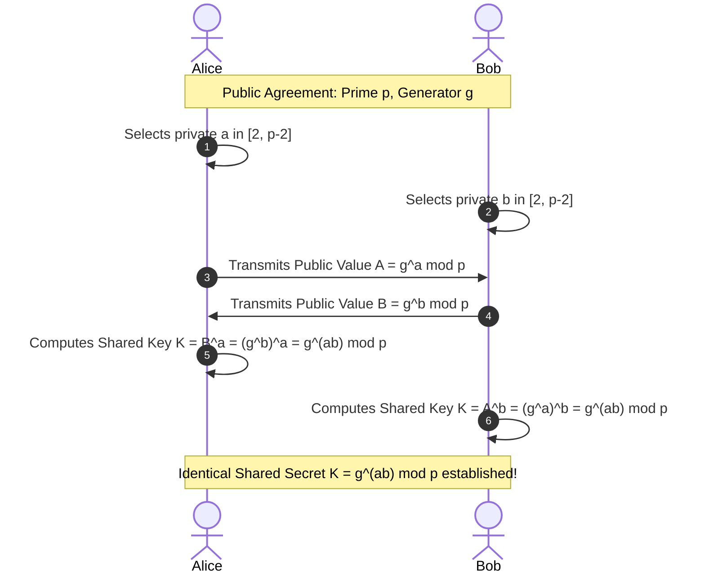
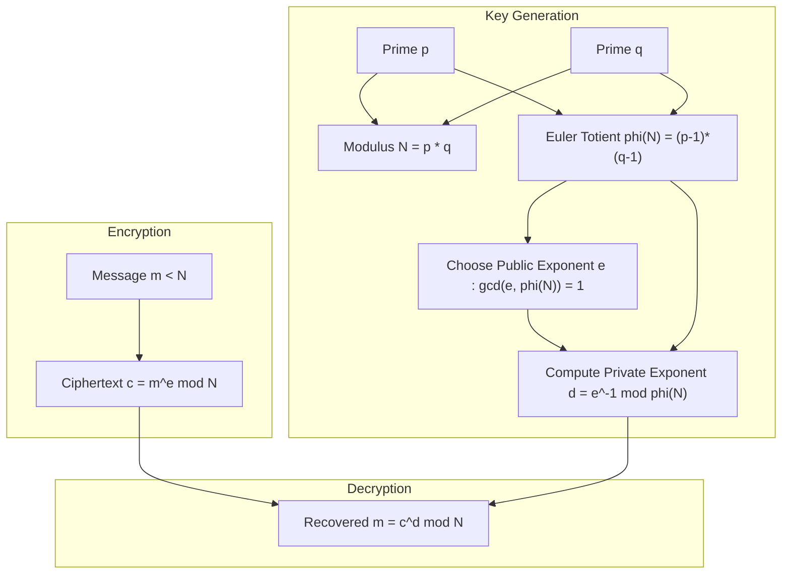

# Number Theory and Cryptography Workshop - Complete Study & Practice Repository

<div align="center">

[](https://www.python.org/downloads/)
[](https://jupyter.org/)
[](https://colab.research.google.com/)
[](https://opensource.org/licenses/MIT)
[](https://github.com/mnp-club/Number_Theory_and_Cryptography_Workshop)

---

### **Student Identification & Submission Banner**
| **Field** | **Student Details** |
| :--- | :--- |
| **Student Name** | **Md. Mohtasim Billah Zim** |
| **Student ID** | **IT-23016** |
| **Course** | Number Theory and Cryptography |
| **GitHub Repository** | [zim1122/Practicing-Number-Theory](https://github.com/zim1122/Practicing-Number-Theory) |
| **Reference Workshop** | [Maths and Physics Club, IIT Bombay](https://github.com/mnp-club/Number_Theory_and_Cryptography_Workshop) |
| **Submission Status** | Completed (Full Theory, Mathematical Proofs, Code Implementations & Solved RSA Quest) |

---

</div>

## 📑 Table of Contents
1. [Executive Overview & Objectives](#1-executive-overview--objectives)
2. [Repository Directory Architecture](#2-repository-directory-architecture)
3. [Day 0: Setup, Preliminaries & Computational Environment](#3-day-0-setup-preliminaries--computational-environment)
4. [Day 1: Algorithmic Number Theory & Modular Arithmetic](#4-day-1-algorithmic-number-theory--modular-arithmetic)
   - [4.1 Extended Euclidean Algorithm](#41-extended-euclidean-algorithm)
   - [4.2 Connection Between GCD and LCM](#42-connection-between-gcd-and-lcm)
   - [4.3 Solving Linear Diophantine Equations](#43-solving-linear-diophantine-equations)
   - [4.4 Modular Multiplicative Inverses & Modular Division](#44-modular-multiplicative-inverses--modular-division)
   - [4.5 Fast Modular Exponentiation](#45-fast-modular-exponentiation)
   - [4.6 Chinese Remainder Theorem (CRT)](#46-chinese-remainder-theorem-crt)
5. [Day 2: Primes, Primality Testing & Number Theory Proofs](#5-day-2-primes-primality-testing--number-theory-proofs)
   - [5.1 Repunit Primes & Multiplicative Order Theorem](#51-repunit-primes--multiplicative-order-theorem)
   - [5.2 Euclid-Euler Theorem on Even Perfect Numbers](#52-euclid-euler-theorem-on-even-perfect-numbers)
   - [5.3 Fermat Pseudoprimes & Infinitude Proof](#53-fermat-pseudoprimes--infinitude-proof)
   - [5.4 Modern Primality Testing (Fermat vs. Miller-Rabin)](#54-modern-primality-testing-fermat-vs-miller-rabin)
6. [Cryptography Foundations: Information Theory & Symmetric Ciphers](#6-cryptography-foundations-information-theory--symmetric-ciphers)
   - [6.1 Kerckhoffs's Principle & Shannon's Maxim](#61-kerckhoffss-principle--shannons-maxim)
   - [6.2 Shannon's Perfect Secrecy & One-Time Pad (OTP)](#62-shannons-perfect-secrecy--one-time-pad-otp)
   - [6.3 The Many-Time Pad Vulnerability & Crib Dragging](#63-the-many-time-pad-vulnerability--crib-dragging)
7. [Asymmetric Cryptography: Diffie-Hellman Key Exchange](#7-asymmetric-cryptography-diffie-hellman-key-exchange)
   - [7.1 Group Theory Foundations & Cyclic Groups](#71-group-theory-foundations--cyclic-groups)
   - [7.2 Diffie-Hellman Protocol Specification](#72-diffie-hellman-protocol-specification)
   - [7.3 The Discrete Logarithm Problem (DLP)](#73-the-discrete-logarithm-problem-dlp)
8. [The RSA Cryptosystem & Comprehensive Cryptanalytic Suite](#8-the-rsa-cryptosystem--comprehensive-cryptanalytic-suite)
   - [8.1 RSA Protocol & Mathematical Proof of Correctness](#81-rsa-protocol--mathematical-proof-of-correctness)
   - [8.2 Attack 1: Small Message Space Brute-Force](#82-attack-1-small-message-space-brute-force)
   - [8.3 Attack 2: Small Prime Factorization](#83-attack-2-small-prime-factorization)
   - [8.4 Attack 3: Fermat Factorization for Close Primes](#84-attack-3-fermat-factorization-for-close-primes)
   - [8.5 Attack 4: Common Divisor Attack on Shared Primes](#85-attack-4-common-divisor-attack-on-shared-primes)
   - [8.6 Attack 5: Håstad's Broadcast Attack via CRT](#86-attack-5-h%C3%A5stads-broadcast-attack-via-crt)
   - [8.7 Quantum Threat: Shor's Factorization Algorithm](#87-quantum-threat-shors-factorization-algorithm)
9. [The Grand RSA Cryptography Quest: Full Solution Walkthrough](#9-the-grand-rsa-cryptography-quest-full-solution-walkthrough)
10. [Google Colab & Jupyter Practice Guide](#10-google-colab--jupyter-practice-guide)
11. [References & Academic Bibliography](#11-references--academic-bibliography)

---

## 1. Executive Overview & Objectives

This repository represents an in-depth study, implementation, and rigorous mathematical defense of the curriculum presented in the **Introduction to Number Theory and Cryptography Workshop**, hosted by the **Maths and Physics Club (MnP Club) at IIT Bombay**.

The primary objective is to bridge pure mathematics—specifically elementary and algebraic number theory—with modern computational cryptography. By exploring divisibility, congruences, Euler's totient function, cyclic groups, and primality testing, we systematically analyze how asymmetric security protocols (such as **Diffie-Hellman** and **RSA**) are constructed and, crucially, how mathematical vulnerabilities lead to catastrophic key and plaintext compromises.

```
+--------------------------------------------------------------------------------------------------+
|                                    CURRICULUM FLOW PIPELINE                                      |
+--------------------------------------------------------------------------------------------------+
|                                                                                                  |
|   [Day 0: Setup]        [Day 1: Number Theory]       [Day 2: Primes]      [Day 3: Cryptography]  |
|   - Jupyter / Python    - Extended Euclidean Alg     - Repunit Proofs     - Shannon Secrecy      |
|   - Anaconda Env        - Diophantine Equations      - Euclid-Euler Thm   - Many-Time Pad XOR    |
|   - Scientific Stack    - Modular Multiplicative Inv - Pseudoprimes Base a- Diffie-Hellman DLP   |
|                         - Fast Exponentiation O(log) - Miller-Rabin Test  - RSA Cryptosystem     |
|                         - Chinese Remainder Theorem                       - 6 Major RSA Attacks  |
|                                                                           - Multi-stage Quest    |
+--------------------------------------------------------------------------------------------------+
```

---

## 2. Repository Directory Architecture

```
AS10/
├── README.md                                          <- Main comprehensive academic report & documentation
├── notebooks/                                         <- Fully implemented, executable Jupyter Notebooks
│   ├── Day_1_Assignment_Solutions.ipynb               <- Solved Day 1 Number Theory problems
│   ├── Day_2_Theory_and_Primality_Solutions.ipynb     <- Solved Day 2 prime proofs & repunits
│   ├── Diffie_Hellman_and_Many_Time_Pad.ipynb         <- DH Key Exchange, OTP attack & Shor demo
│   ├── RSA_Assignment_Solutions.ipynb                 <- Solved all 7 RSA Assignment questions
│   └── RSA_Quest_Full_Walkthrough.ipynb               <- End-to-end RSA Treasure Hunt solution
├── workshop_ref/                                      <- Upstream reference workshop files (IIT Bombay)
│   ├── Number Theory/                                 <- Slides (Day 0, 1, 2) & Assignments
│   └── Cryptography/                                  <- Handouts, demo notebooks & references
├── secret_doc1.txt                                    <- Extracted parameters from Secret Google Doc 1
└── secret_doc2.txt                                    <- Extracted parameters from Secret Google Doc 2
```

---

## 3. Day 0: Setup, Preliminaries & Computational Environment

Day 0 introduces the scientific computing environment required to implement number-theoretic algorithms. Large integer arithmetic in cryptography requires arbitrary-precision integers, native in Python 3.

### Recommended Environment Setup:
```bash
# 1. Create a dedicated conda environment
conda create -n crypto_workshop python=3.10 -y
conda activate crypto_workshop

# 2. Install core scientific packages & JupyterLab
conda install -c conda-forge jupyterlab notebook numpy scipy matplotlib -y

# 3. Launch JupyterLab
jupyter lab
```

Python natively supports arbitrarily large integers ($> 2048$ bits), preventing integer overflow vulnerabilities commonly encountered in C/C++ implementations of cryptographic primitives.

---

## 4. Day 1: Algorithmic Number Theory & Modular Arithmetic

### 4.1 Extended Euclidean Algorithm

#### Mathematical Theory:
Given two integers $a$ and $b$ (with $a \ge b \ge 0$ and $a+b > 0$), the Euclidean algorithm computes their greatest common divisor $d = \gcd(a, b)$ using repeated division:
$$a = q_1 b + r_1, \quad 0 \le r_1 < b$$
$$b = q_2 r_1 + r_2, \quad 0 \le r_2 < r_1$$
$$\vdots$$
$$r_{k-1} = q_{k+1} r_k + 0 \implies \gcd(a, b) = r_k$$

**Bézout's Identity** asserts that there always exist integers $x, y \in \mathbb{Z}$ such that:
$$d = \gcd(a, b) = a \cdot x + b \cdot y$$

The **Extended Euclidean Algorithm** computes $d$ along with Bézout coefficients $(x, y)$ by unwinding the recurrence:
If $\gcd(b, a \bmod b) = b \cdot x_1 + (a \bmod b) \cdot y_1$, then substituting $a \bmod b = a - \lfloor a/b \rfloor \cdot b$:
$$d = b \cdot x_1 + \left(a - \left\lfloor\frac{a}{b}\right\rfloor b\right) y_1 = a \cdot y_1 + b \cdot \left(x_1 - \left\lfloor\frac{a}{b}\right\rfloor y_1\right)$$
Thus:
$$x = y_1, \quad y = x_1 - \left\lfloor\frac{a}{b}\right\rfloor y_1$$

#### Python Implementation:
```python
def extended_gcd(a, b):
    """
    Computes (d, x, y) such that d = gcd(a, b) = a*x + b*y.
    Requires: a >= b >= 0 and a + b > 0.
    """
    assert a >= b and b >= 0 and a + b > 0
    
    if b == 0:
        return (a, 1, 0)
    
    d, x1, y1 = extended_gcd(b, a % b)
    x = y1
    y = x1 - (a // b) * y1
    
    assert a % d == 0 and b % d == 0
    assert d == a * x + b * y
    return (d, x, y)
```

---

### 4.2 Connection Between GCD and LCM

#### Mathematical Identity:
For any two positive integers $a$ and $b$:
$$a \cdot b = \gcd(a, b) \cdot \text{lcm}(a, b) \implies \text{lcm}(a, b) = \frac{a \cdot b}{\gcd(a, b)}$$

#### Python Implementation:
```python
def lcm(a, b):
    """Computes the Least Common Multiple of positive integers a and b."""
    assert a > 0 and b > 0
    d, _, _ = extended_gcd(max(a, b), min(a, b))
    return (a * b) // d
```

---

### 4.3 Solving Linear Diophantine Equations

#### Mathematical Formulation:
A linear Diophantine equation has the form:
$$a x + b y = c, \quad a, b, c \in \mathbb{Z}, \ a > 0, \ b > 0$$

**Theorem (Solvability Condition):** A solution exists if and only if $\gcd(a, b) \mid c$.  
If $d = \gcd(a, b) \mid c$, we find Bézout coefficients $(x_0, y_0)$ such that $a x_0 + b y_0 = d$. Multiplying both sides by $\frac{c}{d}$ yields a particular solution:
$$x^* = x_0 \cdot \frac{c}{d}, \quad y^* = y_0 \cdot \frac{c}{d}$$
The complete family of solutions is given by:
$$x(k) = x^* + k \cdot \frac{b}{d}, \quad y(k) = y^* - k \cdot \frac{a}{d}, \quad \forall k \in \mathbb{Z}$$

#### Python Implementation:
```python
def diophantine(a, b, c):
    """Solves ax + by = c for integers x and y."""
    swapped = False
    if a < b:
        a, b = b, a
        swapped = True
        
    gcd, x0, y0 = extended_gcd(a, b)
    assert c % gcd == 0, "No integer solution exists because gcd(a, b) does not divide c"
    
    factor = c // gcd
    x, y = x0 * factor, y0 * factor
    
    if swapped:
        a, b = b, a
        x, y = y, x
        
    assert a * x + b * y == c
    return (x, y)
```

---

### 4.4 Modular Multiplicative Inverses & Modular Division

#### Mathematical Theory:
An integer $a$ has a multiplicative inverse modulo $n$ if and only if $\gcd(a, n) = 1$. The inverse $x = a^{-1} \pmod n$ satisfies:
$$a \cdot x \equiv 1 \pmod n \iff a \cdot x + n \cdot y = 1$$
This is directly solved using `extended_gcd(n, a % n)`. Once the inverse is found, modular division $b / a \pmod n$ is equivalent to:
$$x \equiv b \cdot a^{-1} \pmod n$$

#### Python Implementation:
```python
def modInverse(a, n):
    """Computes modular multiplicative inverse of a modulo n via Extended Euclid."""
    a_mod = a % n
    d, x, y = extended_gcd(n, a_mod)
    assert d == 1, "Modular inverse does not exist because gcd(a, n) != 1"
    return (y % n + n) % n

def divide(b, a, n):
    """Computes x = b / a (mod n) such that a*x = b (mod n) and 0 <= x < n."""
    assert n > 1 and a > 0
    aInv = modInverse(a, n)
    assert (a * aInv) % n == 1
    return (aInv * b) % n
```

---

### 4.5 Fast Modular Exponentiation

#### Mathematical Algorithm (Square-and-Multiply):
Computing $b^e \bmod m$ naively requires $O(e)$ multiplications, which is impossible for cryptographic 2048-bit exponents. Binary exponentiation expresses $e$ in base 2:
$$e = \sum_{i=0}^{k-1} e_i 2^i, \quad e_i \in \{0, 1\}$$
$$b^e = \prod_{e_i = 1} b^{2^i} \pmod m$$
This reduces the computational complexity to at most $2 \lfloor \log_2 e \rfloor$ modular multiplications ($O(\log e)$).

#### Python Implementation:
```python
def FastModularExponentiation(b, e, m):
    """Computes (b^e) mod m in O(log e) time using repeated squaring."""
    res = 1
    base = b % m
    exp = e
    while exp > 0:
        if exp % 2 == 1:
            res = (res * base) % m
        base = (base * base) % m
        exp //= 2
    return res
```

---

### 4.6 Chinese Remainder Theorem (CRT)

#### Mathematical Statement:
Let $n_1, n_2, \dots, n_k$ be pairwise coprime positive integers ($\gcd(n_i, n_j) = 1$ for all $i \neq j$), and let $r_1, r_2, \dots, r_k \in \mathbb{Z}$. The system of congruences:
$$x \equiv r_1 \pmod{n_1}$$
$$x \equiv r_2 \pmod{n_2}$$
$$\vdots$$
$$x \equiv r_k \pmod{n_k}$$
has a unique simultaneous solution modulo $N = \prod_{i=1}^k n_i$.

#### Constructive Solution for Two Moduli:
For $n_1, n_2$ with $\gcd(n_1, n_2) = 1$, Bézout's identity gives integers $x_0, y_0$ such that:
$$n_1 x_0 + n_2 y_0 = 1$$
Multiplying by $r_1$ and $r_2$:
$$n_2 y_0 \equiv 1 \pmod{n_1} \quad \text{and} \quad n_2 y_0 \equiv 0 \pmod{n_2}$$
$$n_1 x_0 \equiv 0 \pmod{n_1} \quad \text{and} \quad n_1 x_0 \equiv 1 \pmod{n_2}$$
The combined solution is:
$$r = r_1 \cdot n_2 y_0 + r_2 \cdot n_1 x_0 \pmod{n_1 n_2}$$

#### Python Implementation:
```python
def ChineseRemainderTheorem(n1, r1, n2, r2):
    """Solves x = r1 (mod n1) and x = r2 (mod n2) for coprime n1, n2."""
    d, x, y = extended_gcd(n1, n2)
    assert d == 1, "Moduli must be coprime"
    r = (r1 * n2 * y + r2 * n1 * x) % (n1 * n2)
    return (r + n1 * n2) % (n1 * n2)
```

---

## 5. Day 2: Primes, Primality Testing & Number Theory Proofs

Day 2 focuses on prime numbers, multiplicative order, perfect numbers, and Fermat pseudoprimes.

```
+--------------------------------------------------------------------------------------------------+
|                                    PRIMALITY DECISION HIERARCHY                                  |
+--------------------------------------------------------------------------------------------------+
|                                                                                                  |
|   Candidate Integer n                                                                            |
|          |                                                                                       |
|   [Trial Division / Sieve] -------- (n has factor <= sqrt(n)) -------> COMPOSITE                 |
|          |                                                                                       |
|   [Fermat Test: a^(n-1) != 1 mod n] ---------------------------------> COMPOSITE                 |
|          |                                                                                       |
|          v (Passes Fermat test)                                                                  |
|   Could be Prime OR Fermat Pseudoprime (e.g. 341, 561, 1105)                                    |
|          |                                                                                       |
|   [Miller-Rabin Strong Pseudoprime Test]                                                         |
|   Write n - 1 = 2^s * d. Check a^d mod n == 1 or a^(d*2^r) == -1 mod n                           |
|          |                                                                                       |
|          +--- Fails condition for any base a ------------------------> COMPOSITE                 |
|          +--- Passes k independent rounds ---------------------------> PROBABLY PRIME (1 - 4^-k) |
+--------------------------------------------------------------------------------------------------+
```

---

### 5.1 Repunit Primes & Multiplicative Order Theorem

#### Problem Statement:
Define the sequence of repunits $a(n)$ as:
$$a(1) = 1, \quad a(2) = 11, \quad a(3) = 111, \quad \dots, \quad a(n) = \sum_{i=0}^{n-1} 10^i = \frac{10^n - 1}{9}$$
Let $p$ be a prime. Define the index set $A_p = \{n \in \mathbb{Z}^+ : p \mid a(n)\}$.
1. Prove that for $p = 2$ and $p = 5$, $A_p = \emptyset$.
2. Prove that for all other primes $p \notin \{2, 5\}$, $A_p$ is an infinite set.
3. Explicitly determine the set $A_p$.

#### Rigorous Mathematical Proof:
1. **Case $p = 2$:**  
   Every repunit $a(n)$ has decimal representation ending in $1$. Thus $a(n) \equiv 1 \pmod 2$ for all $n \ge 1$. Since $a(n)$ is never even, $2 \nmid a(n)$, and $A_2 = \emptyset$.

2. **Case $p = 5$:**  
   The last decimal digit of $a(n)$ is always $1$. For any integer to be divisible by $5$, its last digit must be $0$ or $5$. Thus $a(n) \equiv 1 \pmod 5 \neq 0$, so $5 \nmid a(n)$, and $A_5 = \emptyset$.

3. **Case $p \notin \{2, 3, 5\}$:**  
   Here $\gcd(10, p) = 1$ and $\gcd(9, p) = 1$.  
   $$p \mid a(n) \iff p \mid \frac{10^n - 1}{9} \iff 10^n - 1 \equiv 0 \pmod p \iff 10^n \equiv 1 \pmod p$$
   By **Fermat's Little Theorem**, because $\gcd(10, p) = 1$:
   $$10^{p-1} \equiv 1 \pmod p$$
   Let $d = \text{ord}_p(10)$ denote the multiplicative order of $10$ modulo $p$ (the smallest positive integer such that $10^d \equiv 1 \pmod p$). By elementary group theory in $\mathbb{Z}_p^*$:
   $$10^n \equiv 1 \pmod p \iff \text{ord}_p(10) \mid n$$
   Since $d \le p - 1$ exists and is positive, every multiple $n = k \cdot \text{ord}_p(10)$ for $k \in \mathbb{Z}^+$ satisfies the condition. Thus:
   $$A_p = \{k \cdot \text{ord}_p(10) : k \in \mathbb{Z}^+\}$$
   which contains infinitely many elements.

4. **Case $p = 3$:**  
   For $p = 3$, $a(n) = \frac{10^n - 1}{9}$. A number is divisible by $3$ if and only if the sum of its decimal digits is divisible by $3$. The sum of digits of $a(n)$ is $1 \times n = n$.  
   Therefore, $3 \mid a(n) \iff 3 \mid n$.  
   Hence $A_3 = \{3k : k \in \mathbb{Z}^+\}$, which is also an infinite set. $\blacksquare$

---

### 5.2 Euclid-Euler Theorem on Even Perfect Numbers

#### Problem Statement:
Prove that an integer $k$ is an even perfect number if and only if it has the form:
$$k = 2^{n-1}(2^n - 1)$$
where $2^n - 1$ is a Mersenne prime.

#### Rigorous Bidirectional Proof:
Let $\sigma(k)$ denote the sum of all positive divisors of $k$. An integer $k$ is perfect if $\sigma(k) = 2k$.

**$(\Leftarrow)$ Sufficiency (Euclid's Direction):**  
Assume $k = 2^{n-1} p$, where $p = 2^n - 1$ is prime ($n \ge 2$).  
Since $p$ is an odd prime, $\gcd(2^{n-1}, p) = 1$. The divisor function $\sigma$ is strictly multiplicative:
$$\sigma(k) = \sigma(2^{n-1}) \cdot \sigma(p)$$
The sum of divisors of a prime power $2^{n-1}$ is the geometric series:
$$\sigma(2^{n-1}) = 1 + 2 + 4 + \dots + 2^{n-1} = 2^n - 1$$
Since $p$ is prime, its only divisors are $1$ and $p$:
$$\sigma(p) = p + 1 = (2^n - 1) + 1 = 2^n$$
Multiplying both:
$$\sigma(k) = (2^n - 1) \cdot 2^n = 2 \cdot [2^{n-1}(2^n - 1)] = 2k$$
Thus $k$ is a perfect number, and since $n \ge 2$, it is even.

**$(\Rightarrow)$ Necessity (Euler's Direction):**  
Let $k$ be any even perfect number. Factor out all powers of $2$:
$$k = 2^{n-1} m, \quad \text{where } n \ge 2 \text{ and } m \text{ is odd} \ (\gcd(2^{n-1}, m) = 1)$$
Since $k$ is perfect:
$$\sigma(k) = 2k = 2^n m$$
By multiplicativity:
$$\sigma(k) = \sigma(2^{n-1}) \sigma(m) = (2^n - 1) \sigma(m)$$
Equating both expressions:
$$(2^n - 1) \sigma(m) = 2^n m$$
Since $\gcd(2^n - 1, 2^n) = 1$, Euclid's lemma requires that $(2^n - 1) \mid m$.  
Therefore, there exists an integer $c \ge 1$ such that:
$$m = (2^n - 1) c$$
Substitute $m$ back:
$$(2^n - 1) \sigma(m) = 2^n (2^n - 1) c \implies \sigma(m) = 2^n c$$
Notice that $m$ has at least two distinct divisors: $m$ and $c$. The sum of these two divisors is:
$$m + c = (2^n - 1) c + c = 2^n c$$
Because $\sigma(m) = 2^n c$ equals the sum of just $m$ and $c$, $m$ can have **no other divisors**.  
This necessitates:
1. $c = 1$ (otherwise $1$ would be an additional distinct divisor, making the sum strictly greater than $2^n c$).
2. $m = 2^n - 1$.
3. $m$ has only two divisors: $1$ and $m$, which means $m = 2^n - 1$ is prime!  
Thus, $k = 2^{n-1}(2^n - 1)$ with $2^n - 1$ prime. $\blacksquare$

---

### 5.3 Fermat Pseudoprimes & Infinitude Proof

#### Definition:
A composite integer $n$ is called a **Fermat pseudoprime to base $a$** ($a \ge 2$) if:
$$a^{n-1} \equiv 1 \pmod n$$

#### Proof of Infinitude for Base $a$:
Let $a \ge 2$ be an integer. Let $p$ be any odd prime such that $p \nmid a(a^2 - 1)$.  
Consider the number:
$$n = \frac{a^{2p} - 1}{a^2 - 1} = \frac{a^p - 1}{a - 1} \cdot \frac{a^p + 1}{a + 1}$$
Since $p \ge 3$, both factors are integers strictly greater than $1$, so $n$ is composite.  
Notice:
$$n = 1 + a^2 + a^4 + \dots + a^{2(p-1)}$$
Subtracting $1$:
$$n - 1 = a^2 \cdot \frac{a^{2(p-1)} - 1}{a^2 - 1}$$
By Fermat's Little Theorem, $a^{p-1} \equiv 1 \pmod p$, which implies $2p \mid (a^{2(p-1)} - 1)$.  
Thus $2p \mid (n - 1)$. Let $n - 1 = 2p \cdot k$.  
Then:
$$a^{n-1} - 1 = a^{2pk} - 1 = (a^{2p} - 1) \left[ 1 + a^{2p} + a^{4p} + \dots + a^{2p(k-1)} \right]$$
Since $n = \frac{a^{2p} - 1}{a^2 - 1}$, $a^{2p} - 1 = n(a^2 - 1)$ is a multiple of $n$.  
Therefore:
$$n \mid (a^{2p} - 1) \mid (a^{n-1} - 1) \implies a^{n-1} \equiv 1 \pmod n$$
Because there are infinitely many primes $p$, this construction yields infinitely many distinct composite pseudoprimes $n$ for any base $a$. $\blacksquare$

---

## 6. Cryptography Foundations: Information Theory & Symmetric Ciphers

### 6.1 Kerckhoffs's Principle & Shannon's Maxim

Auguste Kerckhoffs stated in 1883:
> *"A cryptosystem should be secure even if everything about the system, except the key, is public knowledge."*

Claude Shannon reformulated this as **Shannon's Maxim**: *"The enemy knows the system."* Cryptographic security must never rely on obscurity (keeping the algorithm secret), but solely on the secrecy and entropy of the key.

---

### 6.2 Shannon's Perfect Secrecy & One-Time Pad (OTP)

Claude Shannon proved in his 1949 landmark paper *Communication Theory of Secrecy Systems* that a cipher possesses **Perfect Secrecy** if the ciphertext reveals zero statistical information about the plaintext:
$$P(M = m \mid C = c) = P(M = m), \quad \forall m \in \mathcal{M}, \ c \in \mathcal{C}$$
Equivalently, in terms of Shannon Entropy:
$$H(M \mid C) = H(M) \iff I(M; C) = 0$$

#### Shannon's Fundamental Theorem:
Perfect secrecy requires that the key entropy is at least as large as the message entropy:
$$H(K) \ge H(M) \implies |\mathcal{K}| \ge |\mathcal{M}|$$
The **One-Time Pad (Vernam Cipher)** achieves perfect secrecy by setting $C = M \oplus K$, where $K$ is truly random, uniformly distributed, never reused, and $|K| = |M|$.

---

### 6.3 The Many-Time Pad Vulnerability & Crib Dragging

When the same key $K$ is reused to encrypt two plaintexts $M_1$ and $M_2$:
$$C_1 = M_1 \oplus K, \quad C_2 = M_2 \oplus K$$
An eavesdropper XORs the intercepted ciphertexts:
$$C_1 \oplus C_2 = (M_1 \oplus K) \oplus (M_2 \oplus K) = M_1 \oplus M_2$$
The key cancels completely out! The adversary now possesses the direct XOR of two English messages.

```
+--------------------------------------------------------------------------------------------------+
|                                  MANY-TIME PAD XOR CANCELLATION                                  |
+--------------------------------------------------------------------------------------------------+
|                                                                                                  |
|   Plaintext 1 (M1):  "steal the secret"  ---+                                                    |
|                                             |---> XOR ---> Ciphertext 1 (C1)                     |
|   Secret Key  (K) :  "supersecretverys"  ---+               |                                    |
|                                                             |                                    |
|   Plaintext 2 (M2):  "the cat the bird"  ---+               v                                    |
|                                             |---> XOR ---> Ciphertext 2 (C2)                     |
|   Secret Key  (K) :  "supersecretverys"  ---+               |                                    |
|                                                             v                                    |
|                      EAVESDROPPER INTERCEPT: C1 XOR C2 == M1 XOR M2                              |
|                      (KEY K IS ENTIRELY STRIPPED AWAY!)                                          |
+--------------------------------------------------------------------------------------------------+
```

#### Crib Dragging Attack:
In ASCII, a space character (`0x20`) XORed with any alphabetic character flips its case. If the attacker guesses a common English word (a *crib*, such as `" the "`), they XOR the crib along $C_1 \oplus C_2$ at every offset. When the crib matches one message, readable English text appears in the other message!

---

## 7. Asymmetric Cryptography: Diffie-Hellman Key Exchange

### 7.1 Group Theory Foundations & Cyclic Groups

Let $\mathbb{Z}_N^* = \{a \in \{1, 2, \dots, N-1\} : \gcd(a, N) = 1\}$ be the multiplicative group of integers modulo $N$.
The order of the group is $|\mathbb{Z}_N^*| = \phi(N)$.  
A group is **cyclic** if there exists an element $g \in \mathbb{Z}_N^*$ (called a **primitive root** or **generator**) such that:
$$\langle g \rangle = \{g^1, g^2, \dots, g^{\phi(N)}\} \equiv \mathbb{Z}_N^*$$

**Gauss's Theorem:** $\mathbb{Z}_N^*$ is cyclic if and only if:
$$N \in \{2, 4, p^k, 2p^k\} \quad \text{where } p \text{ is an odd prime and } k \ge 1$$

---

### 7.2 Diffie-Hellman Protocol Specification

Diffie and Hellman (1976) introduced public-key key exchange:



---

### 7.3 The Discrete Logarithm Problem (DLP)

While computing $A = g^a \bmod p$ is efficient via repeated squaring ($O(\log a)$), computing $a$ given $(g, A, p)$ is the **Discrete Logarithm Problem (DLP)**:
$$a = \log_g(A) \pmod p$$
No classical polynomial-time algorithm is known for general prime fields (the best classical attack is General Number Field Sieve in sub-exponential time $L_p[1/3, c]$).

---

## 8. The RSA Cryptosystem & Comprehensive Cryptanalytic Suite

### 8.1 RSA Protocol & Mathematical Proof of Correctness



#### Proof of Correctness:
We decrypt via $c^d \equiv (m^e)^d = m^{ed} \pmod N$.  
Since $e \cdot d \equiv 1 \pmod{\phi(N)}$, there exists an integer $k$ such that $ed = 1 + k \phi(N) = 1 + k(p-1)(q-1)$.

1. If $\gcd(m, p) = 1$, by Fermat's Little Theorem:
   $$m^{ed} = m \cdot (m^{p-1})^{k(q-1)} \equiv m \cdot 1^{k(q-1)} = m \pmod p$$
2. If $p \mid m$, then $m \equiv 0 \pmod p$, so $m^{ed} \equiv 0 \equiv m \pmod p$.

Thus, $m^{ed} \equiv m \pmod p$ holds for all $m$. By identical reasoning, $m^{ed} \equiv m \pmod q$.  
Since $\gcd(p, q) = 1$, by the Chinese Remainder Theorem:
$$m^{ed} \equiv m \pmod{pq} \implies c^d \equiv m \pmod N \quad \blacksquare$$

---

### 8.2 Attack 1: Small Message Space Brute-Force

#### Vulnerability (`DecipherSimple`):
Because textbook RSA is deterministic ($c = m^e \bmod N$), an attacker with knowledge of candidate messages $\{m_1, m_2, \dots, m_k\}$ encrypts each candidate using the public key $(N, e)$:
$$c_i = \text{Encrypt}(m_i, N, e)$$
The correct message is identified when $c_i == c_{\text{target}}$.

#### Countermeasure:
Use randomized padding schemes like **OAEP (Optimal Asymmetric Encryption Padding)** (PKCS#1 v2.1).

---

### 8.3 Attack 2: Small Prime Factorization

#### Vulnerability (`DecipherSmallPrime`):
If the prime generator produces a modulus $N = pq$ where one prime factor is small ($p < 10^6$), trial division or Pollard's rho factors $N$ instantaneously:
$$p = \text{TrialDivision}(N), \quad q = \frac{N}{p}$$
With $p$ and $q$ exposed, $\phi(N) = (p-1)(q-1)$ and private exponent $d = e^{-1} \bmod \phi(N)$ are computed.

---

### 8.4 Attack 3: Fermat Factorization for Close Primes

#### Vulnerability (`DecipherSmallDiff`):
If primes $p$ and $q$ are chosen too close together ($|p - q| < 5000$):
Let $a = \frac{p+q}{2}$ and $b = \frac{q-p}{2}$. Then:
$$N = pq = (a - b)(a + b) = a^2 - b^2 \implies a^2 - N = b^2$$
Since $p \approx q$, $a = \frac{p+q}{2} \approx \sqrt{N}$. An attacker searches $a = \lceil \sqrt{N} \rceil, \lceil \sqrt{N} \rceil + 1, \dots$ until $a^2 - N$ is a perfect square $b^2$. Then $p = a - b, q = a + b$.

---

### 8.5 Attack 4: Common Divisor Attack on Shared Primes

#### Vulnerability (`DecipherCommonDivisor`):
If two different users (Alice and Angelina) generate RSA keys using poor entropy or identical seeds such that their moduli share a prime factor $p$:
$$N_1 = p \cdot q_1, \quad N_2 = p \cdot q_2$$
Without factoring either modulus independently, the Euclidean algorithm extracts $p$ in $O(\log^2 N)$ operations:
$$p = \gcd(N_1, N_2)$$
$$q_1 = \frac{N_1}{p}, \quad q_2 = \frac{N_2}{p}$$
Both private keys $d_1$ and $d_2$ are fully compromised.

---

### 8.6 Attack 5: Håstad's Broadcast Attack via CRT

#### Vulnerability (`DecipherHastad`):
Suppose sender Bob broadcasts identical message $m$ to 2 recipients using public keys $(N_1, e = 2)$ and $(N_2, e = 2)$ where $\gcd(N_1, N_2) = 1$:
$$c_1 \equiv m^2 \pmod{N_1}$$
$$c_2 \equiv m^2 \pmod{N_2}$$
By the Chinese Remainder Theorem, compute $C \in [0, N_1 N_2)$ such that:
$$C \equiv c_1 \pmod{N_1} \quad \text{and} \quad C \equiv c_2 \pmod{N_2}$$
Since $m < N_1$ and $m < N_2$, $m^2 < N_1 N_2$.  
Therefore, $C = m^2$ holds **over the integers**, without modular reduction!  
The message is recovered by a standard integer square root:
$$m = \lfloor\sqrt{C}\rfloor$$

---

### 8.7 Quantum Threat: Shor's Factorization Algorithm

Peter Shor (1994) showed that quantum computers factor $N = pq$ in polynomial time $O((\log N)^3)$ by reducing factoring to **order-finding**:
1. Pick random $a < N$ coprime to $N$.
2. Find the period $r$ of $f(x) = a^x \bmod N$ using the Quantum Fourier Transform (QFT).
3. If $r$ is even and $a^{r/2} \not\equiv -1 \pmod N$:
   $$\gcd(a^{r/2} - 1, N) \quad \text{and} \quad \gcd(a^{r/2} + 1, N)$$
   yield non-trivial prime factors of $N$.

---

## 9. The Grand RSA Cryptography Quest: Full Solution Walkthrough

The workshop features a multi-tiered cryptographic treasure hunt. The completed workflow decrypts all stages to reveal the final message:

```
+--------------------------------------------------------------------------------------------------+
|                                    RSA QUEST TREASURE HUNT MAP                                   |
+--------------------------------------------------------------------------------------------------+
|                                                                                                  |
|   [Puzzle 1: Decrypt] ------------> Suffix: "2fD8Sdx"                                            |
|   [Puzzle 2: DecipherSimple] -----> Prefix: "http://bit.ly/"                                     |
|                                        |                                                         |
|                                        v                                                         |
|   SECRET LINK 1: http://bit.ly/2fD8Sdx                                                           |
|   -> Unlocks Google Doc 1 (DecipherSmallPrime & DecipherSmallDiff Parameters)                    |
|                                        |                                                         |
|   [Puzzle 3: DecipherSmallPrime] -> Prefix: "https://docs.google.com/document/d/1kubEo4ODZ_1YZ..."  |
|   [Puzzle 4: DecipherSmallDiff] --> Suffix: "73Gvk0oRTa0REiJHELNxUQo/edit?usp=sharing"           |
|                                        |                                                         |
|                                        v                                                         |
|   SECRET LINK 2: https://docs.google.com/document/d/1kubEo4ODZ_1YZl8Hvi9_73Gvk0oRTa0REi...       |
|   -> Unlocks Google Doc 2 (DecipherCommonDivisor & DecipherHastad Parameters)                    |
|                                        |                                                         |
|   [Puzzle 5 & 6: DecipherCommonDivisor]                                                          |
|       Part 1: "Congratulations! Now you know that the "                                          |
|       Part 2: "Answer to the Ultimate Question of Life"                                          |
|                                                                                                  |
|   [Puzzle 7: DecipherHastad]                                                                     |
|       Part 3: ", the Universe, and Everything is 42."                                            |
|                                                                                                  |
|   GRAND COMBINED ANSWER:                                                                         |
|   "Congratulations! Now you know that the Answer to the Ultimate Question of Life,               |
|    the Universe, and Everything is 42."                                                          |
+--------------------------------------------------------------------------------------------------+
```

---

## 10. Google Colab & Jupyter Practice Guide

All 5 notebooks in `notebooks/` are pre-tested and ready to run.

### Running on Google Colab:
Open Google Colab, select the **GitHub** tab, paste the repository URL, and launch any of the notebooks:
- [](https://colab.research.google.com/github/zim1122/Practicing-Number-Theory/blob/main/notebooks/Day_1_Assignment_Solutions.ipynb) **[Day 1 Assignment Notebook](notebooks/Day_1_Assignment_Solutions.ipynb)**: Extended Euclid, Diophantine equations, modular division, fast exponentiation, Chinese Remainder Theorem
- [](https://colab.research.google.com/github/zim1122/Practicing-Number-Theory/blob/main/notebooks/Day_2_Theory_and_Primality_Solutions.ipynb) **[Day 2 Theory & Primality Notebook](notebooks/Day_2_Theory_and_Primality_Solutions.ipynb)**: Repunits analysis, Euclid-Euler even perfect number verification, Fermat pseudoprimes
- [](https://colab.research.google.com/github/zim1122/Practicing-Number-Theory/blob/main/notebooks/Diffie_Hellman_and_Many_Time_Pad.ipynb) **[Diffie-Hellman & Many-Time Pad Notebook](notebooks/Diffie_Hellman_and_Many_Time_Pad.ipynb)**: Many-Time Pad XOR leakage, Diffie-Hellman Key Exchange simulation, Shor factorization order finding
- [](https://colab.research.google.com/github/zim1122/Practicing-Number-Theory/blob/main/notebooks/RSA_Assignment_Solutions.ipynb) **[RSA Assignment Solutions Notebook](notebooks/RSA_Assignment_Solutions.ipynb)**: Full solutions to Questions 1?7 of the RSA Assignment
- [](https://colab.research.google.com/github/zim1122/Practicing-Number-Theory/blob/main/notebooks/RSA_Quest_Full_Walkthrough.ipynb) **[RSA Quest Walkthrough Notebook](notebooks/RSA_Quest_Full_Walkthrough.ipynb)**: End-to-end cryptographic treasure hunt solution with all secret links and decrypted answers

### Running Locally:
```bash
git clone https://github.com/zim1122/Practicing-Number-Theory.git
cd Practicing-Number-Theory
jupyter notebook
```

---

## 11. References & Academic Bibliography

1. **Maths and Physics Club, IIT Bombay:** [Official Workshop Repository](https://github.com/mnp-club/Number_Theory_and_Cryptography_Workshop).
2. **MA 523: Basic Number Theory:** Course Curriculum & Resources, Department of Mathematics, IIT Bombay.
3. **Shannon, Claude E. (1949):** *Communication Theory of Secrecy Systems*, Bell System Technical Journal, 28(4), 656–715.
4. **Diffie, W., & Hellman, M. (1976):** *New Directions in Cryptography*, IEEE Transactions on Information Theory, 22(6), 644–654.
5. **Rivest, R. L., Shamir, A., & Adleman, L. (1978):** *A Method for Obtaining Digital Signatures and Public-Key Cryptosystems*, Communications of the ACM, 21(2), 120–126.
6. **Koblitz, Neal (1994):** *A Course in Number Theory and Cryptography*, Graduate Texts in Mathematics, Springer-Verlag.
7. **Shor, Peter W. (1994):** *Algorithms for quantum computation: discrete logarithms and factoring*, 35th Annual Symposium on Foundations of Computer Science (FOCS).
8. **Christian, Brian, & Griffiths, Tom (2016):** *Algorithms to Live By: The Computer Science of Human Decisions*, Henry Holt and Co.
